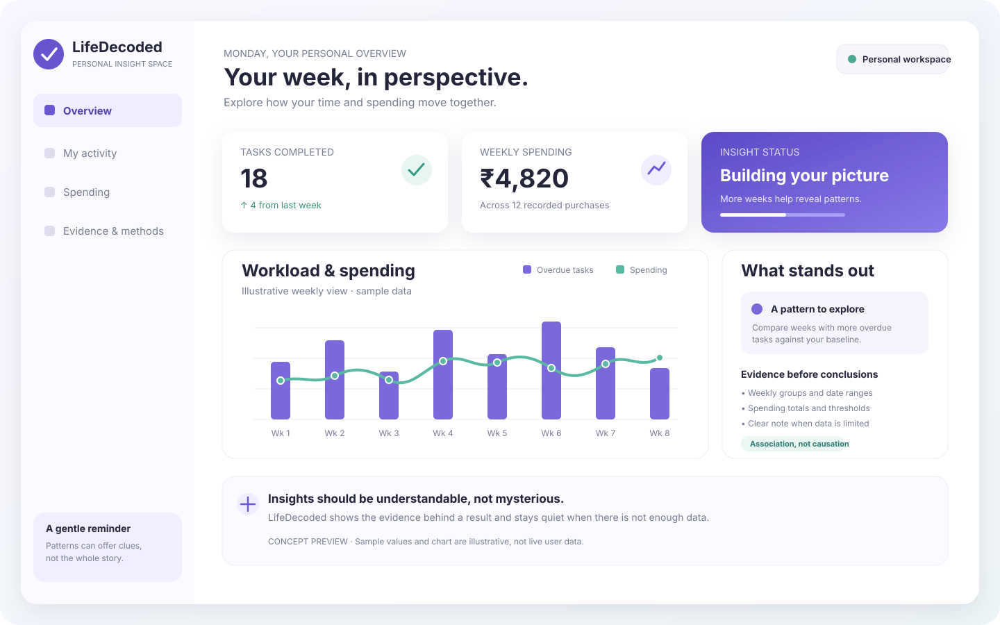

# Life, Decoded ✨
### Understand the patterns behind your everyday choices.

Dashboard concept preview with illustrative sample values. This is a visual mockup, not a live screenshot of the application.

Life, Decoded is a personal insight dashboard that helps people explore how their workload and spending habits relate. Rather than showing totals alone, it explains how each insight is calculated and provides evidence users can inspect.

> **See the pattern. Check the evidence. Make your own interpretation.**

**Important:** The app reports associations in the available data. It does not prove causation or present individual results as population-wide findings.

## 🌱 What You Can Explore

- **Spending and task patterns:** Compare spending across weeks with different levels of overdue tasks.
- **Evidence-backed insights:** Review dates, weekly totals, thresholds, and calculations behind a result.
- **Personal workspace:** Use manually entered records or supported CSV imports without connecting a bank account.
- **Demo personas:** Explore synthetic sample data for Maya and Arjun.
- **CSV transaction import:** Import supported bank or card statement files, with category inference and duplicate-import safeguards.
- **Transparent limitations:** When data is insufficient, the app explains what is missing instead of inventing a conclusion.

## 🧭 How It Works

1. Add or explore records using demo personas or your own supported data.
2. Group observations into weeks and identify qualifying weeks using the configured overdue-task threshold.
3. Compare spending totals across qualifying and baseline weeks when enough observations exist.
4. Inspect the evidence panel for dates, totals, thresholds, and formulas.
5. Interpret the result as an observed association, not proof of cause and effect.

The insight method requires at least **3 qualifying weeks and 3 baseline weeks** within the most recent **12 complete calendar weeks**. If either group is too small, the dashboard reports insufficient data.

## 🧰 Tech Stack

| Layer | Technologies |
|---|---|
| Frontend | React, TypeScript, Vite |
| API and UI data | Axios, React Query |
| Backend | Python 3.11+, FastAPI |
| Insight calculations | Pandas, NumPy |
| Local development | SQLite |
| Production database and authentication | Supabase PostgreSQL, Supabase Auth |
| Testing | pytest, frontend production build |
| Deployment | Vercel (frontend), Railway (backend) |

## 🏗️ Architecture

~~~text
             Browser
      React + TypeScript + Vite
                 |
            API requests
                 |
          FastAPI backend
                 |
       Insight engine and CRUD
          Pandas / NumPy
                 |
        +--------+---------+
        |                  |
        v                  v
   SQLite (local)   Supabase PostgreSQL
                    (production setup)
~~~

Local development defaults to SQLite and synthetic demo data. Production configuration uses Supabase for authentication and PostgreSQL. See the [architecture guide](docs/architecture.md) for details.

## 🚀 Quick Start

### Requirements

- Node.js 18+
- npm 9+
- Python 3.11+

### 1. Clone the repository

~~~bash
git clone https://github.com/swara2402/LifeDecoded.git
cd LifeDecoded
~~~

### 2. Start the backend

From the repository root:

~~~bash
cd backend
python -m venv .venv
~~~

Activate the environment:

~~~bash
# macOS / Linux
source .venv/bin/activate

# Windows PowerShell
.venv\\Scripts\\Activate.ps1
~~~

Install dependencies and start the API:

~~~bash
pip install -r requirements.txt
cp .env.example .env
uvicorn main:app --reload --port 8000
~~~

For the demo setup, check that the environment uses ENVIRONMENT=development and VITE_DEMO_MODE=true. The default local configuration uses SQLite.

### 3. Start the frontend

Open a second terminal at the repository root:

~~~bash
cd frontend
npm install
npm run dev
~~~

Open **http://localhost:5173**. Vite proxies API requests to the backend on port 8000, so VITE_API_BASE_URL can remain unset locally.

### Demo mode vs. real authentication

The default local setup uses synthetic demo personas and is **not real account authentication**. To test Supabase email/password authentication, configure frontend/.env from frontend/.env.example, set VITE_DEMO_MODE=false, and configure the Supabase Auth redirect URL for the local callback.

Never expose a Supabase service-role key in frontend variables or commit real credentials.

## 🔐 Environment Configuration

### Backend: backend/.env

| Variable | Purpose |
|---|---|
| ENVIRONMENT | Development or production configuration |
| DEMO_JWT_SECRET | Secret required by production configuration |
| VITE_DEMO_MODE | Must be false for production backend configuration |
| SUPABASE_URL | Supabase project URL |
| SUPABASE_SERVICE_ROLE_KEY | Server-only service-role key |
| SUPABASE_ANON_KEY | Optional public anon key |
| SUPABASE_JWT_SECRET | Legacy HS256 projects only; never use the anon key as a signing secret |
| SQLITE_PATH | Optional local SQLite database path |
| CORS_ORIGINS | Allowed browser origins; use explicit HTTPS origins in production |
| OVERDUE_THRESHOLD | Overdue-task threshold for qualifying weeks (default: 3) |

### Frontend: frontend/.env

| Variable | Purpose |
|---|---|
| VITE_DEMO_MODE | Select demo workspace or real authentication |
| VITE_SUPABASE_URL | Supabase project URL for real authentication |
| VITE_SUPABASE_PUBLISHABLE_KEY | Browser-safe publishable key |
| VITE_API_BASE_URL | Optional API base URL; local Vite proxy is used when unset |

Environment files are ignored by Git. Verify deployment configuration before enabling public access.

## 🧪 Tests and Checks

Backend tests:

~~~bash
cd backend
python -m pytest tests/ -v --tb=short
~~~

Frontend TypeScript and production build check:

~~~bash
cd frontend
npm run build
~~~

A successful local command is not a substitute for reviewing CI results and testing the actual deployment configuration. See the [testing guide](docs/testing_and_evaluation.md).

## 📥 Import Your Own Transactions

The **Personal** workspace supports importing supported bank or card statement CSV files. Read [Real transaction import and privacy boundaries](docs/real_transaction_import.md) for accepted headers, category inference, and limitations.

- Imports in local/demo mode are scoped to an isolated anonymous workspace.
- Tasks must belong to the same workspace to produce a meaningful personal comparison.
- Avoid uploading sensitive statements to a public demo deployment.
- Review privacy, retention, and access controls before using real financial records in a deployed environment.

## 🌍 Public Research Data

The repository includes a reproducible importer for the public **India Time Use Survey 2024** release. See [Real public-data ingestion](docs/real_public_data.md). Run the importer from the backend directory:

~~~bash
python scripts/import_public_timeuse.py
~~~

This survey is separate from personal financial data. It does not contain linked bank transactions and overdue-task histories, so it must not be used to manufacture personal records or claim that the app's workload-spending hypothesis has been validated. Maya and Arjun remain synthetic demo personas.

## 📚 Documentation

| Guide | What it covers |
|---|---|
| [Architecture](docs/architecture.md) | System design, structure, and technology choices |
| [Insight methodology](docs/insight_methodology.md) | Definitions, formulas, and evidence thresholds |
| [Synthetic data methodology](docs/synthetic_data_methodology.md) | Generation and validation of demo personas |
| [Data dictionary](docs/data_dictionary.md) | Database schema and field descriptions |
| [Privacy and security](docs/privacy_and_security.md) | Authentication, RLS, secrets, and data reset |
| [Testing and evaluation](docs/testing_and_evaluation.md) | Test coverage and manual verification |
| [Demo script](docs/demo_script.md) | Short product walkthrough |
| [Research paper outline](docs/research_paper_outline.md) | Research framing and proposed paper structure |
| [Public datasets](docs/public_datasets.md) | Public data sources and integration rules |
| [Transaction import](docs/real_transaction_import.md) | CSV format, categorization, and privacy boundaries |
| [Public-data ingestion](docs/real_public_data.md) | Reproducible public survey importer |

## ⚠️ Known Limitations

- Demo mode uses SQLite; production requires correctly configured Supabase PostgreSQL and Row Level Security.
- The app does not currently provide direct bank integrations. Transactions are entered manually or imported from supported CSV files.
- Email delivery and password recovery depend on Supabase Auth configuration.
- Useful insights require enough observations in both comparison groups.
- An observed association does not prove causation.
- Production use of personal financial data requires careful review of authentication, access controls, privacy, and retention.

## 🤝 Contributing

Suggestions, bug reports, and improvements are welcome.

1. Fork the repository.
2. Create a focused feature branch.
3. Make your changes and run relevant checks.
4. Open a pull request describing what changed and how it was tested.

Please do not commit secrets, personal financial records, or other sensitive data.

## 📄 License

This project is licensed under the MIT License. See the LICENSE file for details.

---

**Life, Decoded**  
*Your habits have patterns. Understand them with evidence.* ✨
